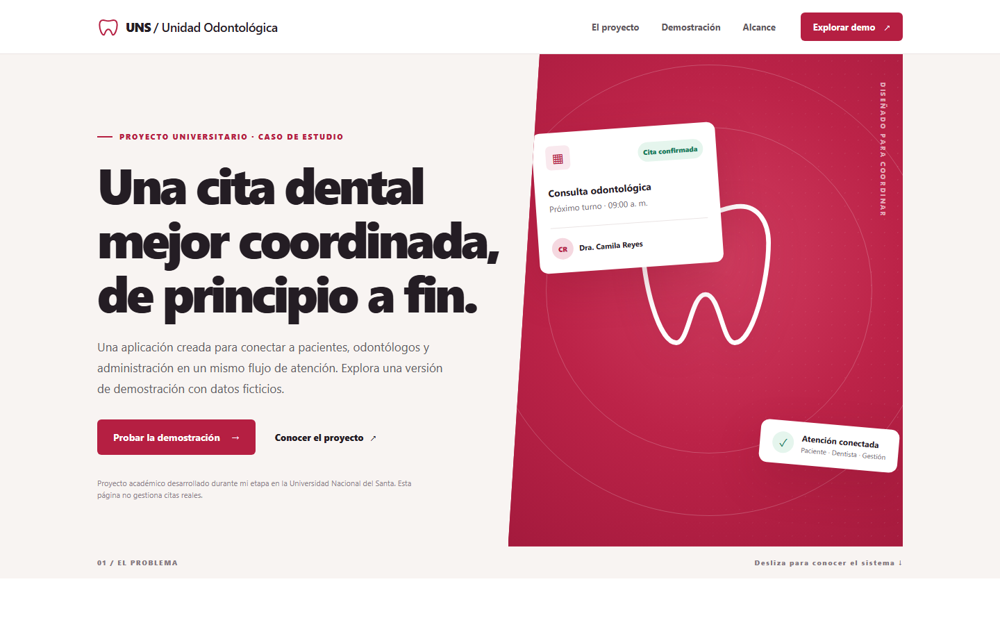
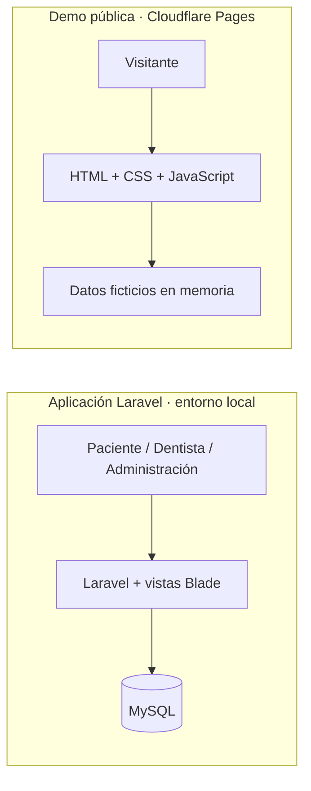

# Unidad Odontológica UNS

**Una agenda odontológica para conectar pacientes, profesionales y administración.** Proyecto académico desarrollado durante mi etapa en la Universidad Nacional del Santa, publicado como caso de estudio con autorización.

[Explorar la demo interactiva](https://unidad-odontologica-uns-demo.pages.dev/) · [Ver los flujos](#qué-hace-la-aplicación) · [Ejecutar el proyecto](#puesta-en-marcha-local)

[](https://unidad-odontologica-uns-demo.pages.dev/)

> **Alcance público.** La web enlazada es una demostración de portfolio con datos ficticios. No es un servicio oficial de la universidad, no crea reservas reales y no recoge información clínica. La aplicación Laravel completa está en este repositorio y se ejecuta de forma local.

## El proyecto en un vistazo

| | Aplicación completa | Demo pública |
| --- | --- | --- |
| Propósito | Gestionar usuarios, especialidades y citas según el rol. | Mostrar los recorridos principales de forma segura e interactiva. |
| Tecnología | Laravel 12, PHP 8.2+, Blade, Bootstrap y MySQL. | HTML, CSS y JavaScript; publicada en Cloudflare Pages. |
| Datos | Base de datos local y datos sintéticos de prueba. | Datos ficticios en la memoria del navegador; se reinician al recargar. |
| Acceso | Requiere configurar y ejecutar el servidor. | [Abrir la demo](https://unidad-odontologica-uns-demo.pages.dev/). |

## Qué hace la aplicación

El sistema organiza una cita desde la solicitud hasta su atención. Cada rol dispone de las herramientas que necesita:

| Rol | Recorrido principal |
| --- | --- |
| **Paciente** | Consultar profesionales, reservar, revisar, reprogramar y cancelar sus citas. |
| **Dentista** | Revisar las citas asignadas y registrar la atención. |
| **Administración** | Consultar la actividad y gestionar usuarios, especialidades, motivos y otros catálogos. |

La [demo interactiva](https://unidad-odontologica-uns-demo.pages.dev/#demo) permite cambiar de perspectiva y probar acciones representativas de los tres roles. Su código y sus instrucciones de publicación están en [`portfolio-demo`](portfolio-demo/README.md).



## Puesta en marcha local

**Requisitos:** PHP 8.2 o superior con las extensiones habituales de Laravel y PDO MySQL, Composer y MySQL. Node.js y npm son opcionales para volver a compilar los recursos de Vite; los recursos que usan las vistas originales ya están incluidos en `public/dist`.

1. Crea una base de datos MySQL vacía llamada `unidad_odontologica`.
2. Instala dependencias y crea tu archivo de configuración local:

   ```bash
   composer install
   cp .env.example .env
   php artisan key:generate
   ```

   En PowerShell, sustituye `cp` por `Copy-Item .env.example .env`.

3. Ajusta `DB_USERNAME` y `DB_PASSWORD` en `.env` para tu instalación de MySQL.
4. Crea el esquema y los datos de ejemplo; después inicia el servidor:

   ```bash
   php artisan migrate --seed
   php artisan serve
   ```

Abre `http://127.0.0.1:8000`. El registro público crea cuentas de **paciente**. Los datos sembrados son sintéticos y las cuentas de ejemplo tienen contraseñas aleatorias: no hay credenciales predeterminadas para iniciar sesión.

<details>
<summary>Configurar el evento de MySQL y probar el panel administrativo</summary>

La migración `actualizar_estado_citas` crea un evento que actualiza citas vencidas. El usuario de MySQL necesita el privilegio `EVENT` y el planificador de eventos del servidor debe estar activo. La suite de pruebas utiliza SQLite en memoria y omite esa migración específica.

Para explorar el panel de administración en **tu instalación local**, registra primero una cuenta con tu propia contraseña. Luego ejecuta `php artisan tinker` y asigna el rol administrador únicamente a esa cuenta:

```php
App\Models\Usuario::where('correo', 'tu-correo@example.com')->update(['rol_id' => 1]);
```

</details>

## Estructura del repositorio

```text
app/                Lógica de la aplicación, modelos y controladores
database/           Migraciones, fábricas y datos sintéticos
resources/views/    Vistas Blade de los tres roles
public/dist/        Recursos originales que utilizan las vistas
portfolio-demo/     Demo pública independiente y guía de despliegue
tests/              Pruebas de comportamiento y seguridad
docs/               Vista previa para este README
```

## Verificación y estado

```bash
php artisan test
composer validate --no-check-publish
composer audit --locked
npm run build
```

En Windows, si PowerShell bloquea el script de npm, usa `npm.cmd run build`. La compilación de Vite se genera en `public/build`, que está ignorado por Git.

La última revisión local, el **10 de octubre de 2026**, completó las pruebas automatizadas y no encontró avisos en `composer audit --locked`. Esto describe el estado de las dependencias fijadas en esa fecha; antes de operar el backend con pacientes o datos reales hace falta una revisión adicional de seguridad, privacidad, copias de seguridad y configuración del servidor.

## Publicación y derechos

El código se comparte con autorización como trabajo académico. La demo pública usa datos ficticios y funciona sin API ni base de datos; el backend Laravel no está desplegado públicamente. No publiques `.env`, bases de datos, logs, exportaciones ni datos reales de pacientes.

Este repositorio no concede una licencia de reutilización del código a terceros. Las dependencias mantienen sus propias licencias.
